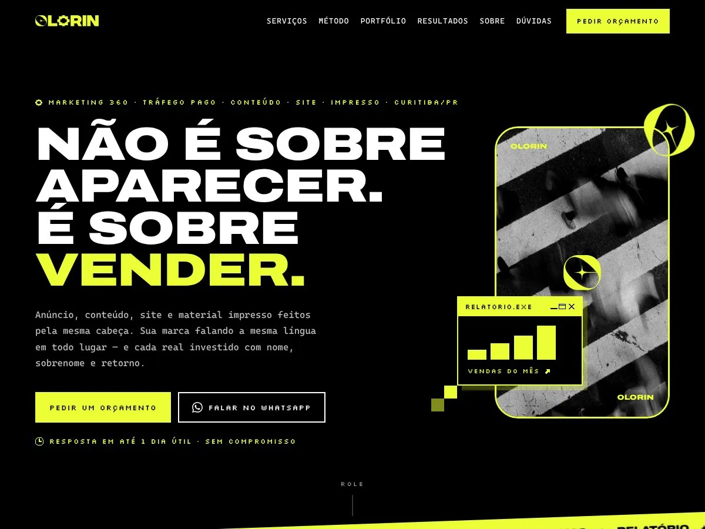
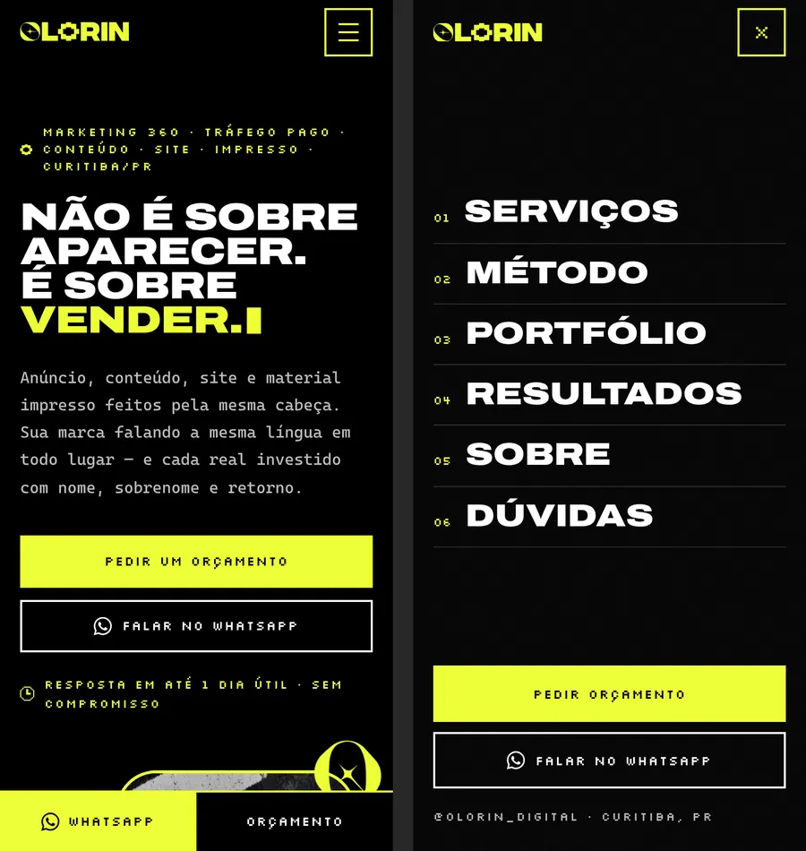
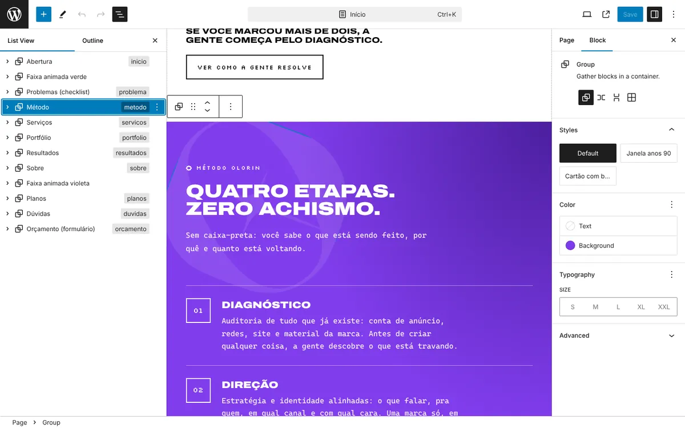
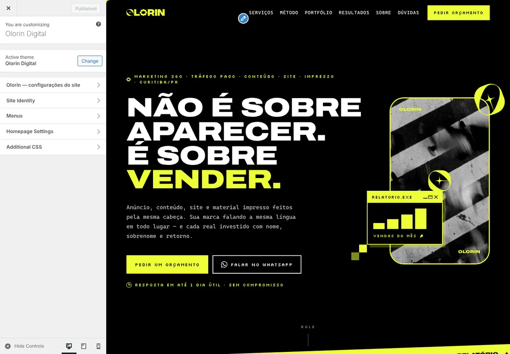
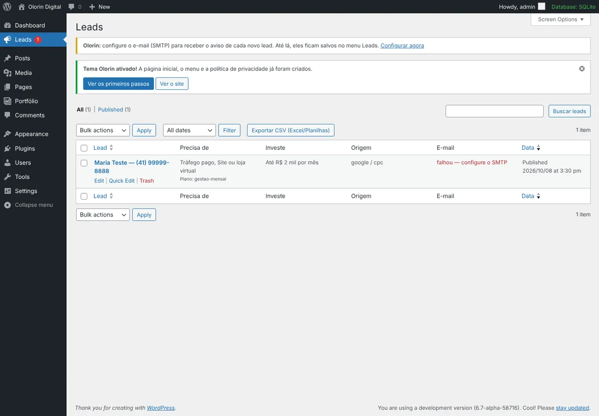

# Olorin Digital — site oficial

Site da agência **Olorin Digital** (marketing 360, Curitiba/PR), feito a partir do protótipo do Figma e do manual de identidade visual, pronto para publicar na **Locaweb** e editar pelo painel do WordPress.



---

## Sumário

1. [O que tem aqui](#1-o-que-tem-aqui)
2. [Qual caminho escolhemos e por quê](#2-qual-caminho-escolhemos-e-por-quê)
3. [Publicar na Locaweb (WordPress) — passo a passo](#3-publicar-na-locaweb-wordpress--passo-a-passo)
4. [Como editar o site no dia a dia](#4-como-editar-o-site-no-dia-a-dia)
5. [Antes de divulgar: o que você precisa conferir](#5-antes-de-divulgar-o-que-você-precisa-conferir)
6. [Alternativa: versão em HTML puro](#6-alternativa-versão-em-html-puro)
7. [Identidade visual aplicada](#7-identidade-visual-aplicada)
8. [Qualidade: velocidade, SEO, acessibilidade e LGPD](#8-qualidade-velocidade-seo-acessibilidade-e-lgpd)
9. [Para desenvolvedores](#9-para-desenvolvedores)

---

## 1. O que tem aqui

| Arquivo / pasta | Para que serve |
|---|---|
| **`entrega/olorin-tema-wordpress.zip`** | **O site.** Tema para instalar no WordPress (caminho recomendado). |
| `entrega/olorin-site-estatico.zip` | Alternativa sem WordPress: o mesmo site em HTML, para enviar por FTP. |
| `tema-wordpress/olorin/` | Código-fonte do tema (o mesmo conteúdo do .zip). |
| `site-estatico/` | Código-fonte da versão HTML. |
| `docs/imagens/` | Imagens deste guia. |
| `ferramentas/` | Scripts para gerar os .zip e a versão HTML. |

**Para baixar um .zip pelo GitHub:** abra a pasta `entrega`, clique no arquivo e depois em **Download** (ícone de seta, à direita).

O site tem 12 seções, todas editáveis e reordenáveis:

`Abertura` → `Faixa animada verde` → `Problemas (checklist)` → `Método` → `Serviços` → `Portfólio` → `Resultados` → `Sobre` → `Faixa animada violeta` → `Planos` → `Dúvidas` → `Orçamento (formulário)`

Além disso: menu com links para as seções, menu de tela cheia no celular, botão flutuante de WhatsApp, barra fixa WhatsApp/Orçamento no celular, Política de Privacidade (LGPD), página 404 e blog.



---

## 2. Qual caminho escolhemos e por quê

**Recomendação: WordPress na Locaweb com o tema sob medida "Olorin".**

O pedido era: subir na Locaweb e conseguir editar depois — textos, imagens e a **ordem dos blocos** — sem perder o visual do Figma.

| | **Tema Olorin no WordPress** ✅ | WordPress + Elementor | HTML puro (FTP) |
|---|---|---|---|
| Editar textos e imagens sem mexer em código | Sim, clicando no texto | Sim | Não |
| Mudar a ordem das seções | Sim (setas ↑↓ ou arrastar) | Sim | Não |
| Fidelidade ao design do Figma | Total | Parcial | Total |
| Velocidade | Altíssima (nota 100 no Lighthouse em computador) | Mais lento (muito CSS/JS) | Máxima |
| Pedidos de orçamento salvos no painel | Sim, com exportação para Excel | Depende de plugin | Planilha CSV no servidor |
| Blog e páginas novas (SEO) | Sim | Sim | Não |
| Plugins pagos | Nenhum | Elementor Pro (pago) para formulários e temas | Nenhum |

Por isso o tema foi construído com o **editor de blocos nativo do WordPress**: cada seção é um bloco que você edita, duplica, apaga e reordena, e o visual continua idêntico porque o estilo está no tema. Não depende de nenhum plugin.

A versão em HTML puro também está pronta (seção 6), caso você prefira não usar WordPress.

---

## 3. Publicar na Locaweb (WordPress) — passo a passo

> As telas do painel da Locaweb mudam com o tempo. Os nomes abaixo vêm da Central de Ajuda da Locaweb (links no fim desta seção). Se algo estiver com outro nome, procure pelo assunto na ajuda.

### 3.1 Antes de começar

- **Plano:** Hospedagem de Sites (Linux) ou Hospedagem WordPress da Locaweb.
- **PHP:** 8.1 ou mais novo (mínimo 7.4). No painel: domínio → **Administrar** → versão do PHP.
- **Domínio:** de preferência já apontado para a Locaweb. **Instale o WordPress direto no domínio final** (ex.: `olorindigital.com.br`), não num endereço temporário — assim nenhum link quebra depois.

### 3.2 Instalar o WordPress

1. No painel da Locaweb, ao lado do domínio, clique em **Administrar**.
2. Na aba **Aplicativos**, escolha **WordPress** → **Instalar WordPress**. Se aparecer um banner de "WordPress com IA", ignore: use o instalador tradicional.
3. Escolha **português do Brasil**, crie usuário e **senha forte** (guarde num gerenciador de senhas) e aguarde até 5 minutos sem fechar a página.
4. Se você contratou a **Hospedagem WordPress**, o caminho é: Central do Cliente → **Hospedagem WordPress** → **Criar novo site**.

### 3.3 Ativar o cadeado (HTTPS)

1. No painel: domínio → **Administrar** → **Let's Encrypt** → emitir o certificado. Pode levar algumas horas.
2. Depois de emitido, no WordPress: **Configurações → Geral** → troque `http://` por `https://` nos dois endereços e salve.
3. Para forçar o HTTPS em todas as páginas, a própria Locaweb sugere o plugin **Really Simple SSL** (Plugins → Adicionar novo → instalar e ativar).

### 3.4 Instalar o tema Olorin

1. Baixe **`entrega/olorin-tema-wordpress.zip`** (não descompacte).
2. No WordPress: **Aparência → Temas → Adicionar novo → Enviar tema** → escolha o .zip → **Instalar agora** → **Ativar**.
3. Pronto. Ao ativar, o tema **monta o site sozinho**:
   - cria a página **Início** com todas as seções e define como página inicial;
   - cria o **Menu principal** (Serviços, Método, Portfólio…);
   - publica a **Política de Privacidade** (modelo LGPD);
   - ativa links amigáveis e desliga comentários (evita spam).

> Se o envio falhar por tamanho de arquivo: descompacte o .zip no computador e envie a pasta `olorin` por FTP (FileZilla) para `public_html/wp-content/themes/`. Depois ative em Aparência → Temas. Dados de FTP: painel → **Arquivos e FTP**.

### 3.5 Primeiros passos dentro do WordPress

Abra **Aparência → Olorin: primeiros passos**. Lá estão os atalhos para:

1. **WhatsApp, e-mail e redes** (Aparência → Personalizar → Olorin → Contato e WhatsApp). Todos os botões de WhatsApp do site passam a usar o número que você salvar aqui.
2. **E-mail de aviso de novos leads (SMTP)** — obrigatório na Locaweb, que bloqueia o envio simples de e-mail do PHP:
   1. No painel da Locaweb, crie uma caixa de e-mail (ex.: `site@seudominio.com.br`).
   2. No WordPress: **Configurações → E-mail (SMTP)** → marque **Ativar SMTP** e preencha:
      - Servidor: `email-ssl.com.br` · Porta: `465` · Segurança: `SSL`
      - Usuário: o e-mail completo da caixa · Senha: a senha dessa caixa
      - Remetente: o mesmo e-mail
   3. Clique em **Enviar e-mail de teste**.
   4. Mesmo antes disso, nenhum pedido se perde: todos ficam no menu **Leads**.
3. **Deixar o site mais rápido**: botão **Ativar compressão e cache** (grava regras seguras no `.htaccess`; dá para desfazer no mesmo botão).
4. **Rastreamento (opcional)**: cole o ID do Google Tag Manager (`GTM-…`), do GA4 (`G-…`, só se não usar GTM) e/ou do Meta Pixel. O aviso de cookies aparece sozinho.
5. Em **Configurações → Leitura**, confira se **"Evitar que mecanismos de busca indexem este site"** está **desmarcado**.
6. Apague o post "Olá, mundo!" e a "Página de exemplo" que o WordPress cria (Posts / Páginas → Lixeira).

### 3.6 Fontes da Central de Ajuda da Locaweb

- [Instalação do WordPress na Hospedagem de Sites](https://www.locaweb.com.br/ajuda/wiki/instalacao-facil-e-pratica-de-wordpress-hospedagem-de-sites/)
- [Certificado Let's Encrypt](https://www.locaweb.com.br/ajuda/wiki/como-emitir-o-certificado-lets-encrypt-hospedagem-de-sites) e [site "não seguro"](https://www.locaweb.com.br/ajuda/wiki/site-nao-seguro-como-resolver/)
- [SMTP no WordPress (WP Mail SMTP, dados email-ssl.com.br / 465 / SSL)](https://www.locaweb.com.br/ajuda/wiki/como-configurar-o-plugin-wp-mail-smtp-hospedagem-de-sites/)
- [Função mail() do PHP na Locaweb](https://www.locaweb.com.br/ajuda/wiki/como-enviar-e-mails-com-a-funcao-mail-do-php-hospedagem-de-sites/)
- [Alterar a versão do PHP](https://www.locaweb.com.br/ajuda/wiki/como-alterar-a-versao-do-php-hospedagem-de-sites-ajuda-locaweb)
- [Diretório raiz do site (public_html)](https://www.locaweb.com.br/ajuda/?p=5584)

---

## 4. Como editar o site no dia a dia

### Textos, imagens e ordem das seções

Vá em **Páginas → Início → Editar**.



| Quero… | Como fazer |
|---|---|
| **Trocar um texto** | Clique no texto e digite. Para quebrar linha num título: `Shift + Enter`. |
| **Destacar uma palavra em verde** (como "VENDER.") | Selecione a palavra → seta ⌄ da barra de formatação → **Destaque** (*Highlight*) → aba **Texto** → **Verde**. |
| **Trocar uma imagem** | Clique na imagem → **Substituir** → envie a nova. |
| **Mudar a ordem das seções** | Abra a **Visão geral** (ícone ☰ no topo, à esquerda). Clique na seção e use as setas **↑ ↓** da barra do bloco, ou arraste na lista. |
| **Duplicar** (novo serviço, nova pergunta, novo problema) | Selecione o cartão/pergunta → **⋮** → **Duplicar**. Numeração e animações se ajustam sozinhas. |
| **Apagar** uma seção ou item | Selecione → **⋮** → **Excluir**. |
| **Recolocar uma seção apagada** | **+** (azul, no topo) → **Padrões** → **Olorin — seções do site**. |
| **Mudar a cor de fundo de uma seção** | Selecione a seção → barra lateral → **Cor → Fundo**. Só aparecem as 4 cores da marca; textos e botões se ajustam sozinhos. |
| **Destacar um plano** | Mude o fundo do cartão do plano para **Verde**: ele ganha sombra e sobe. |
| **Trocar o ícone pixel de um serviço** | Clique no ícone → barra lateral → **Desenho do ícone**. |
| **Transformar um bloco em "janela anos 90"** | Selecione um Grupo → **Estilos → Janela anos 90**. O primeiro parágrafo vira a barra de título (ex.: `case_04.exe`). |
| **Mudar estilo de botão** | Selecione o botão → **Estilos**: Verde, Violeta, Preto, Branco ou Contorno. |

Depois de editar, clique em **Salvar** (ou **Atualizar**, conforme a versão do WordPress), no canto superior direito.

### Atalhos de link para botões

Ao editar o link de um botão, use:

| Escreva no link | O que acontece |
|---|---|
| `#whatsapp` | Abre o WhatsApp com a mensagem padrão |
| `#whatsapp=Oi! Quero falar sobre site` | Abre o WhatsApp com essa mensagem |
| `#orcamento` | Rola até o formulário |
| `#orcamento-gestao-mensal` | Rola até o formulário e registra o plano no lead |
| `#instagram` · `#linkedin` · `#email` | Usa os links salvos em Personalizar |

No meio de um texto, `[olorin_telefone]` mostra o telefone salvo e `[olorin_email]` mostra o e-mail.

### Outras partes do site

| O quê | Onde |
|---|---|
| WhatsApp, e-mail, Instagram, LinkedIn, cidade, CNPJ | **Aparência → Personalizar → Olorin → Contato e WhatsApp** |
| Textos dos botões do topo | Personalizar → Olorin → **Topo do site** |
| Links do menu | **Aparência → Menus** ("Menu principal") |
| Rodapé (frase, lista de serviços, direitos) | Personalizar → Olorin → **Rodapé** |
| Formulário (opções, faixas de investimento, e-mail que recebe, mensagem de sucesso) | Personalizar → Olorin → **Formulário de orçamento** |
| Título e descrição no Google, imagem de compartilhamento | Personalizar → Olorin → **SEO e compartilhamento** |
| GTM, GA4, Meta Pixel, texto do aviso de cookies | Personalizar → Olorin → **Rastreamento e cookies** |
| Cursor de estrela, botão flutuante, barra do celular | Personalizar → Olorin → **Efeitos e botões flutuantes** |
| Logo diferente / ícone da aba | Personalizar → **Identidade do site** |



### Portfólio

**Portfólio → Adicionar projeto**: título (cliente ou segmento), **imagem do projeto**, **resumo** (legenda, ex.: "Identidade visual · Papelaria"), **Tipo de trabalho** (vira o filtro) e, se quiser, um link. A ordem é definida em **Atributos → Ordem**. Assim que o primeiro projeto real for publicado, os exemplos somem.

### Leads (pedidos de orçamento)

Menu **Leads**: todos os pedidos com nome, WhatsApp, serviços, investimento, origem (utm/gclid/fbclid) e data. Abra um lead para ver tudo e clicar em **Responder no WhatsApp**. O botão **Exportar CSV** gera uma planilha para Excel/Google Planilhas.



### Blog e páginas novas

- **Blog:** crie uma página chamada "Blog" e, em **Configurações → Leitura**, escolha-a como "Página de posts". Depois é só publicar em **Posts → Adicionar**.
- **Landing page de campanha:** **Páginas → Adicionar**, escolha o modelo **"Página com seções (largura total)"** (barra lateral → Modelo) e insira as seções em **+ → Padrões → Olorin**.

### Desfazer e voltar ao original

- Toda página tem histórico: barra lateral → aba **Página** → **Revisões**.
- **Aparência → Olorin: primeiros passos → Criar rascunho com a página original** cria uma cópia da página inicial original para você copiar uma seção de volta.

---

## 5. Antes de divulgar: o que você precisa conferir

O site está pronto, mas alguns dados vieram do protótipo e **não podem ir ao ar sem confirmação**. Publicar números ou cases que não são reais é propaganda enganosa (Código de Defesa do Consumidor e CONAR).

- [ ] **Números da seção Resultados** (R$12M+ geridos, 87+ marcas, 4,42x de retorno, 320+ peças/mês) — confirme ou troque.
- [ ] **Os 3 cases** (R$ 380k em 90 dias, 8x, 3 meses) — só publique se forem reais e autorizados pelo cliente.
- [ ] **Preços dos planos** e a nota "a verba de anúncio é investida à parte".
- [ ] **WhatsApp e e-mail**: hoje estão os de exemplo — `(41) 90000-0000` e `oi@olorindigital.com.br`.
- [ ] **Seção Sobre**: texto da Natália e a **foto** (hoje é uma foto de bastidores do manual da marca; uma foto real de quem atende converte mais).
- [ ] **Portfólio**: as imagens atuais são **exemplos ilustrativos** (fotos de banco do protótipo do Figma, licença Unsplash). Cadastre trabalhos reais.
- [ ] **Política de Privacidade**: revise nome da empresa, CNPJ, cidade e e-mail do encarregado (DPO).
- [ ] **Perguntas frequentes**: prazos, verba mínima e regras de contrato.
- [ ] **SMTP** configurado e **e-mail de teste** recebido.
- [ ] Faça um pedido de orçamento de teste pelo celular e confira se aparece em **Leads**.

---

## 6. Alternativa: versão em HTML puro

Se preferir **não usar WordPress**, `entrega/olorin-site-estatico.zip` tem o mesmo site em HTML/CSS/JS:

1. Descompacte no computador.
2. Edite **`config.php`**: e-mail que recebe os pedidos, WhatsApp e SMTP da Locaweb (`email-ssl.com.br`, 465, SSL, e-mail e senha da caixa).
3. Troque o WhatsApp e o e-mail de exemplo dentro de `index.html`, `politica-de-privacidade/index.html` e `404.html` (use "Localizar e substituir" de um editor como o VS Code).
4. Envie **todo o conteúdo** (inclusive os arquivos ocultos `.htaccess`) para `public_html` por FTP ou pelo Gerenciador de Arquivos da Locaweb.
5. Depois de ativar o SSL, descomente o bloco "HTTPS obrigatório" do `.htaccess`.

Os pedidos chegam por e-mail e ficam salvos em `leads/pedidos.csv` (pasta bloqueada para visitantes; baixe por FTP). Para editar textos, é preciso mexer no HTML — por isso o WordPress é o caminho recomendado.

---

## 7. Identidade visual aplicada

| Elemento | No site |
|---|---|
| Cores | Verde `#ECFF36`, Violeta `#7E3BED`, Preto `#000000`, Branco `#FFFFFF` (valores exatos tirados dos vetores do manual). |
| Regras do manual | Verde + preto + branco e violeta + preto + branco. **Violeta nunca encosta no verde**: a faixa violeta foi posicionada entre Sobre (preto) e Planos (branco), e o cursor/botão flutuante mudam de cor sobre o violeta. |
| Logo | Vetorizado direto do PDF (`assets/img/brand/logo-olorin.svg`), além do símbolo "O" e do símbolo pixel. |
| Fonte principal (Integral CF) | Integral CF é paga; usamos **Archivo Expanded 900**, praticamente idêntica e gratuita (licença OFL). |
| Fonte de textos longos | **Cascadia Code** — a mesma do manual. |
| Fonte secundária (Retro Computer) | **Silkscreen**, pixel e gratuita, no lugar da Retro Computer. |
| Clima anos 90 | Janelas de sistema (`relatorio.exe`, `case_01.exe`, `orcamento.exe`, `cookies.exe`), ícones em pixel art para cada serviço, cursor de estrela, letreiros inclinados, grão analógico, cursor piscando no título e medidores pixel. |
| Fotos | Do próprio manual (faixa de pedestres no celular, bastidores, olho na página 404). |

**Tem a licença da Integral CF?** Coloque `IntegralCF-Black.woff2` em `assets/fonts/`, troque o arquivo no `@font-face` "Archivo Expanded" de `assets/css/olorin.css` e pronto.

---

## 8. Qualidade: velocidade, SEO, acessibilidade e LGPD

Testes feitos num WordPress real antes da entrega:

- **Lighthouse (computador): 100 em Performance, Acessibilidade, Boas práticas e SEO.** No celular (teste com internet 4G lenta simulada): 100 em acessibilidade, boas práticas e SEO, e performance entre 90 e 94 com a compressão do servidor ligada — por isso o botão **Ativar compressão e cache** (seção 3.5) é importante. Sem compressão, fica em torno de 88.
- **Acessibilidade (axe-core):** zero erros. Contraste AA, navegação por teclado, foco visível, menu acessível, formulário com mensagens de erro lidas por leitores de tela e animações desligadas para quem prefere menos movimento.
- **Editor de blocos:** as 12 seções e os 250 blocos da página inicial abrem sem nenhum aviso de "bloco inválido".
- **Responsivo:** testado de 360 px a 2560 px, sem rolagem lateral.
- **SEO:** título e descrição editáveis, Open Graph (imagem de compartilhamento pronta), dados estruturados (empresa, site e perguntas frequentes), sitemap do WordPress e `lang="pt-BR"`. Se você instalar Yoast ou Rank Math, o tema desliga o próprio SEO para não duplicar.
- **Leve:** sem jQuery, sem bibliotecas, fontes e imagens no próprio servidor (nada do Google Fonts — melhor para a LGPD), imagens em WebP.
- **LGPD:** aceite obrigatório no formulário, Política de Privacidade pronta, cookies de medição só depois do "Aceitar" (Google Consent Mode v2; Meta Pixel só carrega após o aceite).
- **Formulário:** 2 etapas, máscara de telefone, funciona até sem JavaScript, anti-spam (campo isca, tempo mínimo e limite por IP), salva o lead **antes** de enviar o e-mail e oferece "Adiantar pelo WhatsApp" com o resumo do pedido.
- **Rastreamento pronto para o GTM** (eventos no `dataLayer`): `olorin_whatsapp_click`, `olorin_cta_click`, `olorin_form_start`, `olorin_form_step`, `generate_lead`, `olorin_portfolio_filter`, `olorin_consent`. Os botões principais têm IDs fixos (`cta-whatsapp-topo`, `cta-whatsapp-flutuante`, `cta-whatsapp-barra-mobile`…). Os leads guardam utm_source/medium/campaign/content/term, gclid e fbclid.

---

## 9. Para desenvolvedores

```
tema-wordpress/olorin/
├── style.css · theme.json · functions.php
├── header.php · footer.php · front-page.php · page.php · single.php · index.php · 404.php
├── template-secoes.php          modelo "Página com seções (largura total)"
├── inc/
│   ├── helpers.php              opções, WhatsApp, atalhos de link, SVG, ícones
│   ├── setup.php                suportes, scripts, limpeza do <head>, shortcodes
│   ├── customizer.php           Aparência → Personalizar → Olorin
│   ├── blocks.php               blocos próprios, estilos de bloco, categoria de padrões
│   ├── portfolio.php            tipo de conteúdo Projeto + filtros
│   ├── leads.php                endpoint do formulário, lista de leads, CSV
│   ├── smtp.php                 SMTP (Configurações → E-mail)
│   ├── seo.php · tracking.php   meta tags, JSON-LD, GTM/GA4/Pixel + consentimento
│   └── onboarding.php           monta o site ao ativar, primeiros passos, .htaccess
├── patterns/                    as 12 seções (blocos nativos)
├── blocks/                      icone · portfolio · formulario (blocos dinâmicos)
└── assets/                      css · js · fonts · img
```

- **Requisitos:** WordPress 6.6+ e PHP 7.4+ (testado em WordPress 6.7 com PHP 8.3).
- **Sem etapa de build:** CSS e JS são editáveis direto. A versão dos arquivos usa a data de modificação, então o navegador atualiza sozinho após mudanças.
- **Regerar os .zip:** `bash ferramentas/empacotar.sh`.
- **Regerar a versão HTML** (com um WordPress local rodando o tema): `python3 ferramentas/exportar_estatico.py --origem http://localhost:8080 --dominio https://seudominio.com.br`.
- **GitHub Actions:** `verificar.yml` confere a sintaxe (PHP 7.4 e 8.3, JS e theme.json) a cada mudança. `publicar-tema-locaweb.yml` envia o tema por FTP quando acionado manualmente, se você cadastrar os segredos `LOCAWEB_FTP_SERVIDOR`, `LOCAWEB_FTP_USUARIO`, `LOCAWEB_FTP_SENHA` e `LOCAWEB_TEMA_PASTA`.
- **Ganchos:** `do_action( 'olorin_lead_received', $lead, $post_id )` para integrar CRM/planilhas.

### Licenças

- Tema: GPL v2 ou posterior.
- Fontes Archivo, Cascadia Code e Silkscreen: SIL Open Font License 1.1 (`assets/fonts/LICENCA-FONTES.txt`).
- Fotos de exemplo do portfólio: Unsplash (vindas do protótipo do Figma) — substitua por trabalhos reais.
- Logo, símbolos e fotos do manual: propriedade da Olorin Digital.
